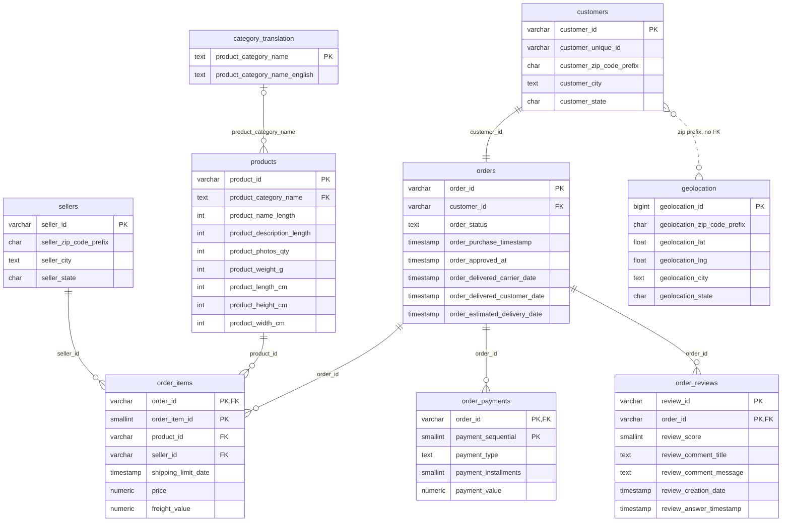

# Do late deliveries hurt review scores? An Olist e-commerce analysis

**Question:** On a Brazilian e-commerce marketplace, how much does a late delivery lower a customer's review score, and what should the business do about it?

**Data:** [Brazilian E-Commerce Public Dataset by Olist](https://www.kaggle.com/datasets/olistbr/brazilian-ecommerce): about 100,000 real orders from 2016 to 2018 across 9 linked tables.

**Tools:** PostgreSQL, SQL (CTEs, window functions), Python (pandas, SciPy, statsmodels), Jupyter.

> Status: **Step 1 of 5 done.** The database is built, keyed and checked.

---

## Project plan

- [x] **1. Database:** schema with primary and foreign keys, load all 9 CSVs, validate the load
- [ ] **2. SQL analysis:** monthly revenue, repeat customers, delivery time by state, best and worst sellers
- [ ] **3. Statistics:** late vs on-time review scores (test + effect size + confidence interval), shipping cost across regions, regression, a bootstrapped confidence interval
- [ ] **4. Notebook:** one clean notebook that tells the story with charts
- [ ] **5. Summary:** one page that ends with a business recommendation and says plainly what the data can't prove

## Repo layout

```
olist-delivery-reviews/
├── data/raw/              # the Kaggle CSVs go here (not committed to git)
├── docs/data_notes.md     # every data quirk found and what was done about it
├── notebooks/             # analysis notebook (step 4)
├── sql/
│   ├── 01_create_schema.sql
│   ├── 02_load_data.sql
│   └── 03_check_load.sql
└── README.md
```

## How to reproduce (macOS)

**1. Install PostgreSQL.** Download [Postgres.app](https://postgresapp.com/downloads.html) (the Universal build runs on Intel and Apple Silicon Macs), move it to Applications, open it and click **Initialize**.

**2. Put `psql` on your PATH.** Run this once in Terminal, then close and reopen Terminal:

```bash
sudo mkdir -p /etc/paths.d && echo /Applications/Postgres.app/Contents/Versions/latest/bin | sudo tee /etc/paths.d/postgresapp
```

Check it worked with `psql --version`.

**3. Create the database:**

```bash
createdb olist
```

**4. Get the data.** Download the dataset zip from Kaggle (free account needed) and unzip the 9 CSVs into `data/raw/`.

**5. Build, load and check.** From the repo root:

```bash
psql -d olist -f sql/01_create_schema.sql
psql -d olist -f sql/02_load_data.sql
psql -d olist -f sql/03_check_load.sql
```

The load takes about 15 seconds. Every row in check 1 should say `OK`.

## Database diagram

`customer_id` is unique per order, so customers to orders is one-to-one. The real person is `customer_unique_id`. The dotted line means geolocation joins on zip prefix but has no foreign key (see [data notes](docs/data_notes.md)).



## Data source and license

Released by Olist on Kaggle under CC BY-NC-SA 4.0 (non-commercial, share-alike). The raw CSVs are not included in this repo; download them from Kaggle.
